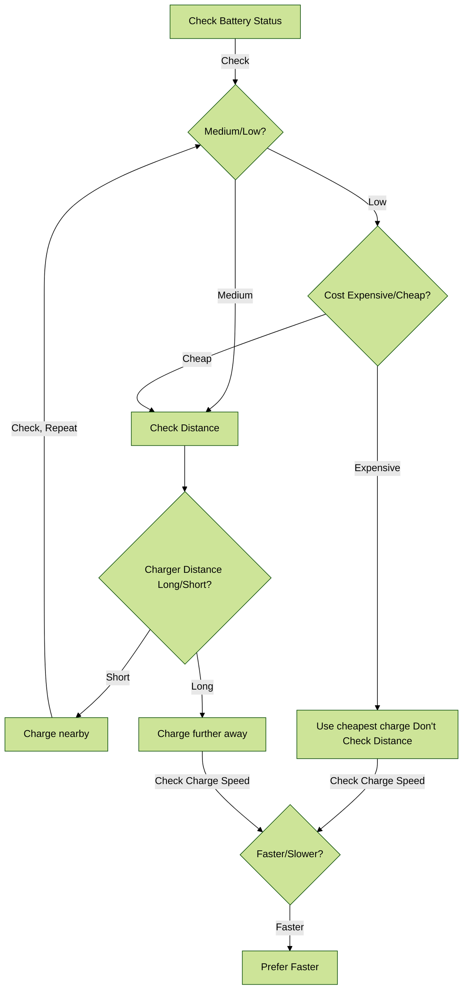

## ⚡ EV Charge Scenarios App ⚡

### Important Note:

**This webapp was created for my own personal purpose and car make (Smaller 40KWh battery, older Type-1 charger). This might not be particularly useful for larger EV sizes and longer distances.**

&nbsp;&nbsp;

This project was created because of lack of proper maintenance on EV charging infrastructure support **(intermittent EV public charger disruption or often faults)** and to cover as much as possible cases for closest locations to further facilitate ev charging with a slower charging car.

&nbsp;

Even though I am not a __salesman__ nor __travelling__ (pun intentional ;-P), I follow a simple deterministic process to charge my car and minimizing delays due to the lack of proper infrastructure and intermittent public charger disruptions in my home country. Also, I cannot use a home charger for now, so this becomes particularly useful.

My charging decision diagram is described in the flowchart below

&nbsp;&nbsp;

Long story short and to avoid any misunderstandings on the diagram, what is described is that if it costs more to charge the vehicle, then plan to get the cheapest AND fastest charge available regardless of distance to not waste a long time waiting. Otherwise, try and plan according to shortest walking distance charger regardless of pricing. This applies to all cities mentioned in the webapp graphs.

 Also this is done in case that a charger is not operable and have to repeat the process to select another one manually.

__Note:__
Data are externally mapped via third party API and some stats/combinations produced to display how many combinations are available while following the process above.